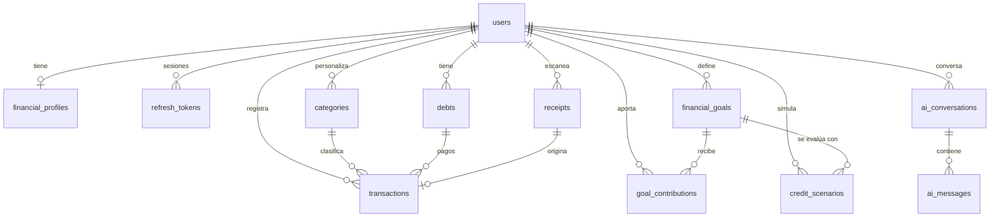

# Modelo de datos

Fuente de verdad: [`backend/prisma/schema.prisma`](../backend/prisma/schema.prisma). Migración inicial: `backend/prisma/migrations/20261013000000_init`.

## Tablas

| Tabla | Propósito | Notas |
|---|---|---|
| `users` | Cuenta y consentimientos | Contraseña solo como hash bcrypt. Fechas de aceptación de privacidad, IA y OCR. |
| `refresh_tokens` | Sesiones activas | Solo se guarda el hash SHA-256; rotación en cada uso. |
| `financial_profiles` | Parámetros del usuario | Moneda, ingreso estimado, % de ahorro deseado, meses de fondo de emergencia. |
| `categories` | Categorías de ingreso/gasto | `user_id` nulo = categoría del sistema. |
| `transactions` | Movimientos | `client_id` único por usuario para sincronización idempotente; borrado lógico. |
| `debts` | Deudas | Saldo, tasa (E.A. o M.V.), cuota, plazo, día de pago. |
| `financial_goals` | Metas múltiples | Valor objetivo, ahorro inicial, fecha deseada, prioridad, estado. |
| `goal_contributions` | Aportes a metas | Incluye `user_id` para autorizar sin consultar la meta. |
| `credit_scenarios` | Simulaciones guardadas | Supuestos + copia de resultados (`result_snapshot`). |
| `ai_conversations` / `ai_messages` | Historial de IA | Solo si el usuario decide conservarlo; tokens usados para controlar costos. |
| `receipts` | Recibos por OCR | Campos extraídos y estado; la imagen no se conserva (`image_deleted_at`). |

## Reglas

- Todo registro financiero tiene dueño (`user_id`) y se elimina en cascada al borrar la cuenta.
- Montos: `DECIMAL(15,2)`. Tasas: `DECIMAL(9,6)` como fracción (0,245 = 24,5 %).
- Toda consulta del backend filtra por el `user_id` del token: un usuario nunca puede leer ni modificar registros de otro.
