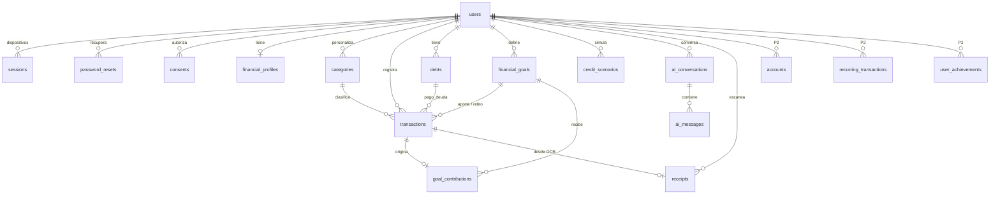

# Modelo de datos v2

Fuente de verdad: [`apps/api/prisma/schema.prisma`](../apps/api/prisma/schema.prisma). Sigue la sección 10 del Documento Maestro v2.

Migraciones:
1. `20261013000000_init` — modelo v1.
2. `20261013090000_modelo_datos_v2` — reemplaza el v1 por el v2 (el v1 no tenía datos reales).

## Reglas

- **Dinero en pesos enteros** (`BIGINT`); tasas en `DECIMAL(9,6)` como fracción. Nunca `float`. En JSON se envían como número.
- **Tipos de movimiento:** `ingreso`, `gasto`, `pago_deuda`, `aporte_meta`, `retiro_meta` (los mismos de `finance-core`).
- Toda consulta filtra por el `user_id` del token. Al eliminar la cuenta se borra todo en cascada.
- `client_op_id` único por usuario: un reintento no duplica (RNF-12).
- `deleted_at` en movimientos, deudas y metas para sincronizar borrados.
- `saved_amount` de una meta y `balance` de una deuda se recalculan en la misma transacción que crea el movimiento.
- Las imágenes de recibos nunca se guardan.
- `app_settings` (una fila): tasa de usura de referencia con su fecha (se registra a mano, no se inventa) y límites diarios de IA.

| Tabla | Prioridad | Nota |
|---|---|---|
| users | P1 | `is_adult`, contador de intentos fallidos y `locked_until` (RF-02) |
| sessions | P1 | Hash del token de renovación, `device_name`, rotación |
| password_resets | P1 | HMAC del código, vence en 15 min, `attempts`, `used_at` |
| consents | P1 | `terminos`, `datos`, `ia`, `ocr` con versión |
| financial_profiles | P1 | Ingreso y gastos fijos estimados, día de pago, margen 0,8 |
| categories | P1 | Por defecto del sistema o del usuario; se archivan |
| transactions | P1 | Tipo, monto, fecha, categoría, deuda / meta / cuenta opcionales, origen |
| debts | P1 | Acreedor, monto, saldo, tasa EA/MV, cuota, plazo, día de pago, estado |
| financial_goals | P1 | Objetivo, ahorrado, fecha, prioridad alta/media/baja, fondo de emergencia |
| goal_contributions | P1 | + aporte / − retiro, ligado a su movimiento |
| credit_scenarios | P1 | Entradas, resultados y versión del motor |
| ai_conversations / ai_messages | P1 | Rol, contenido y tokens |
| app_settings | P1 | Configuración global |
| receipts, accounts, recurring_transactions, user_achievements | P2 | Creadas, se usan cuando llegue su etapa |
