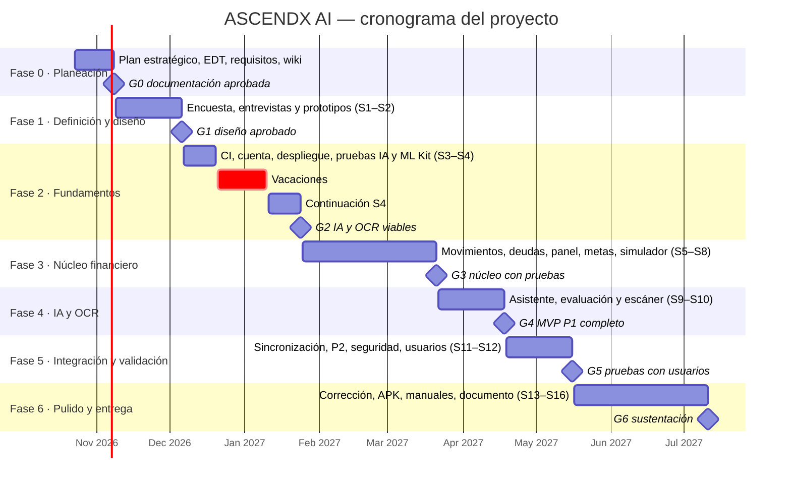

# Cronograma

El proyecto empieza con dos semanas de planeación y documentación (Fase 0) y sigue con **16 sprints de dos semanas** entre el 9 de noviembre de 2026 y el 11 de julio de 2027, con una pausa por vacaciones del 21 de diciembre al 10 de enero. Cada fase termina en una puerta de control con el director. Las fechas se ajustarán al calendario académico oficial.

## Avance real frente al plan (27 de octubre de 2026)

El desarrollo va adelantado: el prototipo funcional de las fases 2 a 5 ya está construido y probado (ver [Requisitos funcionales](Requisitos-funcionales) y `docs/estado.md`). El cronograma no se acorta: el tiempo ganado se usa en lo que el plan pone después del código.

| Fase | Plan | Real |
| --- | --- | --- |
| 2 · Fundamentos | dic. 2026 – ene. 2027 | Terminada (cuenta, despliegue, CI local) |
| 3 · Núcleo financiero | ene. – mar. 2027 | Terminada |
| 4 · IA y OCR | mar. – abr. 2027 | Terminada en código; falta probar ML Kit en el teléfono (puerta G2) |
| 5 · Integración | abr. – may. 2027 | Funciones P2 y sin conexión terminadas; faltan pruebas con usuarios y en dispositivos |

Las fases 1 (encuesta, entrevistas y prototipos con usuarios), 5 (validación) y 6 (cierre) se mantienen en sus fechas, porque dependen de personas y del calendario académico.

## Diagrama de Gantt

## Sprints

| Sprint | Fechas | Fase | Objetivo del sprint |
| --- | --- | --- | --- |
| — | 23 oct – 8 nov 2026 | 0 | Plan estratégico, plan del proyecto, EDT, requisitos, cronograma, normas y wiki |
| S1 | 9 – 22 nov 2026 | 1 | Aplicar encuesta (≥ 30) y entrevistas (5) |
| S2 | 23 nov – 6 dic 2026 | 1 | Diagnóstico, backlog ajustado, prototipos y arquitectura aprobados |
| S3 | 7 – 20 dic 2026 | 2 | Integración continua, revisión de cuenta y despliegue; comparar proveedores de IA |
| — | 21 dic 2026 – 10 ene 2027 | — | Pausa por vacaciones |
| S4 | 11 – 24 ene 2027 | 2 | Prueba de ML Kit en un build; elegir proveedor de correo; APK de prueba |
| S5 | 25 ene – 7 feb 2027 | 3 | Movimientos, categorías y aviso de duplicados (HU-01 a HU-03) |
| S6 | 8 – 21 feb 2027 | 3 | Deudas y capacidad de ahorro con historial (HU-04 a HU-06) |
| S7 | 22 feb – 7 mar 2027 | 3 | Gráficos del panel y metas con prioridad (HU-07, HU-08) |
| S8 | 8 – 21 mar 2027 | 3 | Aportes, proyección y escenarios guardados (HU-09 a HU-11) |
| S9 | 22 mar – 4 abr 2027 | 4 | Contexto de IA, resumen y explicación de metas (HU-12) |
| S10 | 5 – 18 abr 2027 | 4 | Plan de acción, chat, evaluación de la IA, caché y OCR (HU-13 a HU-15) |
| S11 | 19 abr – 2 may 2027 | 5 | Sincronización sin conexión y revisión de seguridad (HU-16) |
| S12 | 3 – 16 may 2027 | 5 | Funciones P2 y pruebas con 10–15 usuarios (HU-17, HU-18) |
| S13 | 17 – 30 may 2027 | 6 | Corrección de hallazgos de la prueba |
| S14 | 31 may – 13 jun 2027 | 6 | Optimización, APK final y manuales |
| S15 | 14 – 27 jun 2027 | 6 | Documento de grado con resultados |
| S16 | 28 jun – 11 jul 2027 | 6 | Ajustes finales y preparación de la sustentación |

## Puertas de control

| Puerta | Fecha prevista | Se aprueba si… |
| --- | --- | --- |
| G0 | 8 nov 2026 | La documentación de planeación está completa en la wiki |
| G1 | 6 dic 2026 | Hay diagnóstico, backlog priorizado, prototipos y arquitectura |
| G2 | 24 ene 2027 | IA y OCR son viables, o hay un plan alternativo documentado |
| G3 | 21 mar 2027 | El núcleo P1 funciona con cobertura ≥ 90 % en el motor |
| G4 | 18 abr 2027 | El MVP P1 está completo y la IA pasa su evaluación; se congela el alcance |
| G5 | 16 may 2027 | Hay informe de usabilidad y de seguridad |
| G6 | 11 jul 2027 | Entregables de grado listos para sustentar |

**Plan de recorte:** si en G4 el MVP P1 no está completo, se recorta en este orden: recordatorios, cuentas, movimientos recurrentes, gamificación, registro sin conexión y, por último, OCR.
