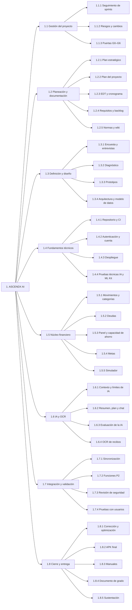

# EDT / WBS del proyecto

La Estructura de Desglose del Trabajo (EDT, en inglés WBS) divide **todo** el trabajo del proyecto en paquetes que se pueden planear, asignar y verificar. Sigue la regla del 100 %: lo que no está en la EDT no hace parte del proyecto.

## Diagrama

## Diccionario de la EDT

| Código | Paquete de trabajo | Descripción | Entregable verificable | Horas estimadas |
| --- | --- | --- | --- | --- |
| 1.1.1 | Seguimiento de sprints | Planeación, revisión y retrospectiva de cada sprint | Registro de sprint en la wiki | 26 |
| 1.1.2 | Riesgos y cambios | Revisión de riesgos y registro de decisiones | `docs/decisiones.md` actualizado | 12 |
| 1.1.3 | Puertas G0–G6 | Preparar y presentar cada puerta al director | Acta o aprobación de cada puerta | 14 |
| 1.2.1 | Plan estratégico | Misión, visión, DOFA, objetivos e indicadores | Página Plan estratégico | 6 |
| 1.2.2 | Plan del proyecto | Alcance, entregables, riesgos, calidad, comunicación | Página Plan del proyecto | 6 |
| 1.2.3 | EDT y cronograma | Descomposición del trabajo y fechas por sprint | Páginas EDT y Cronograma | 4 |
| 1.2.4 | Requisitos y backlog | RF, RNF e historias con criterios de aceptación | Páginas de requisitos e historias | 8 |
| 1.2.5 | Normas y wiki | Revisión de normas ISO/IEC y publicación de la wiki | Página Normas y wiki publicada | 6 |
| 1.3.1 | Encuesta y entrevistas | Aplicar el cuestionario (≥ 30) y 5 entrevistas | Base de respuestas anonimizada | 24 |
| 1.3.2 | Diagnóstico | Analizar resultados y ajustar prioridades | Informe de diagnóstico | 12 |
| 1.3.3 | Prototipos | Pantallas clave en Figma | Prototipo navegable | 20 |
| 1.3.4 | Arquitectura y modelo de datos | Ajustar diagrama de capas y entidad-relación | Documento de arquitectura aprobado | 12 |
| 1.4.1 | Repositorio y CI | Monorepo, lint, tipos y pruebas automáticas | Pipeline en verde | 10 |
| 1.4.2 | Autenticación y cuenta | Registro, sesión, recuperación, consentimientos, borrado | RF-01 a RF-06 con pruebas | 30 |
| 1.4.3 | Despliegue | API en Render, base de datos en Neon, variables seguras | URL pública en funcionamiento | 8 |
| 1.4.4 | Pruebas técnicas IA y ML Kit | Comparar 2 proveedores de IA; probar ML Kit en un build | Decisión documentada | 16 |
| 1.5.1 | Movimientos y categorías | CRUD, filtros, duplicados, categorías | RF-07 a RF-10 | 40 |
| 1.5.2 | Deudas | Registro de deudas y pagos | RF-11 y RF-12 | 24 |
| 1.5.3 | Panel y capacidad de ahorro | Indicadores del mes y gráficos | RF-13 a RF-15 | 30 |
| 1.5.4 | Metas | Metas múltiples, aportes, proyección y riesgo | RF-16 a RF-19 | 36 |
| 1.5.5 | Simulador | Ahorro, crédito y mixto; tasas; escenarios guardados | RF-20 a RF-22 | 24 |
| 1.6.1 | Contexto y límites de IA | Constructor de contexto, límites y consentimiento | Contexto sin datos de identificación | 16 |
| 1.6.2 | Resumen, plan y chat | Funciones de IA en la app | RF-23 a RF-26 | 28 |
| 1.6.3 | Evaluación de la IA | 30 preguntas con rúbrica | Informe: 100 % sin invenciones, ≥ 85 % aprobado | 12 |
| 1.6.4 | OCR de recibos | Escaneo, revisión y medición con 30 recibos | RF-28 e informe de precisión | 28 |
| 1.7.1 | Sincronización | Caché, registro sin conexión e idempotencia | RF-27 y RF-29 | 30 |
| 1.7.2 | Funciones P2 | Recurrentes, cuentas, gamificación, recordatorios, comparación | RF-30 a RF-34 (según el plan de recorte) | 30 |
| 1.7.3 | Revisión de seguridad | Pruebas de acceso cruzado y revisión con OWASP MASVS | Lista de chequeo diligenciada | 12 |
| 1.7.4 | Pruebas con usuarios | Sesiones con 10–15 participantes y SUS | Informe de usabilidad | 24 |
| 1.8.1 | Corrección y optimización | Ajustes según hallazgos | Lista de hallazgos cerrada | 22 |
| 1.8.2 | APK final | Compilación firmada con EAS | APK instalable | 6 |
| 1.8.3 | Manuales | Manual de usuario y manual técnico | Dos manuales | 16 |
| 1.8.4 | Documento de grado | Informe final con resultados | Documento aprobado | 40 |
| 1.8.5 | Sustentación | Presentación y ensayo | Presentación y guion | 8 |
| | **Total** | | | **≈ 640** |

> Las horas son una estimación inicial (≈ 20 horas por semana durante 32 semanas) y se ajustan al final de cada sprint.
