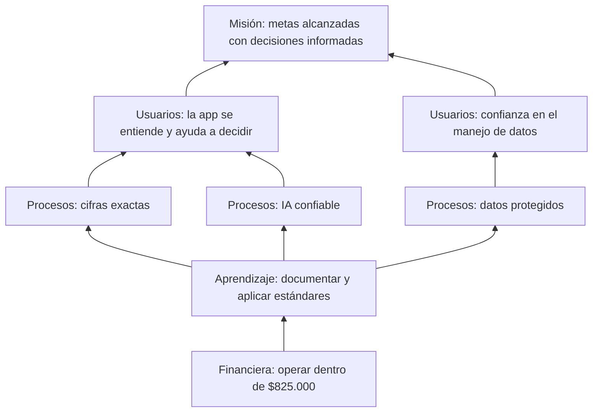

# Plan estratégico

Este plan fija hacia dónde va ASCENDX AI y cómo se sabrá si avanza. Une el propósito académico (proyecto de grado y semillero) con la proyección del producto (una base seria para una futura versión comercial).

## 1. Propósito

### Misión

Ayudar a las personas adultas en Colombia a entender su situación financiera y a alcanzar sus metas, con cálculos confiables y explicaciones claras, sin comprometer su estabilidad económica.

### Visión (a 2028)

Ser una aplicación de referencia en Colombia para planear metas personales y decidir entre ahorrar o financiar una compra, reconocida por la exactitud de sus cifras, el respeto por los datos de sus usuarios y una inteligencia artificial que explica sin inventar.

### Propuesta de valor

> «Convierte potencial en progreso medible.» Registra lo que ganas, gastas y debes; descubre cuánto puedes ahorrar sin riesgo; reparte ese ahorro entre tus metas y compara, antes de endeudarte, cuánto te cuesta realmente financiar.

### Valores

| Valor | Cómo se ve en el producto |
| --- | --- |
| Exactitud | Las cifras salen de un motor de cálculo con pruebas automáticas, nunca de la IA |
| Transparencia | Cada simulación muestra sus supuestos; la IA muestra los datos que usó |
| Privacidad | Consentimientos separados para IA y OCR; la IA no recibe datos de identificación; el usuario puede borrar su cuenta |
| Responsabilidad | La app no promete rendimientos, no garantiza créditos y no se presenta como asesoría profesional |
| Simplicidad | Lenguaje sencillo y pocas decisiones por pantalla |

## 2. Diagnóstico

### Contexto

- El 54,4 % de los encuestados no ahorraba, el 18 % guardaba su ahorro en alcancías o en casa y el 29 % de quienes pidieron un préstamo acudió a fuentes informales (Encuesta de demanda de inclusión financiera, 2022).
- El acceso ya no es el problema: más del 96 % de los adultos tiene un producto financiero y el 35,5 % tiene un crédito vigente (Reporte de Inclusión Financiera 2024).
- Los modelos de IA aciertan cerca del 68 % en preguntas de finanzas personales (Hean, Saha y Saha, 2025), por lo que no deben calcular.

### Análisis DOFA

| | Positivo | Negativo |
| --- | --- | --- |
| **Interno** | **Fortalezas** F1. Prueba de concepto ya desplegada en la nube F2. Motor de cálculo con 49 pruebas y 99,2 % de cobertura F3. Arquitectura que separa cálculo e IA F4. Costo bajo (≈ $825.000) con software libre F5. Identidad visual definida | **Debilidades** D1. Un solo desarrollador D2. Proveedor de IA y de correo aún sin elegir D3. Sin pruebas en teléfonos reales todavía D4. Sin datos propios de usuarios de Cali (encuesta pendiente) |
| **Externo** | **Oportunidades** O1. Alta bancarización y baja planificación O2. Política Nacional de IA (CONPES 4144 de 2025) O3. 43,7 % de disposición de pago en un estudio local (EDUFIN, Icesi) O4. Herramientas gratuitas de IA en el dispositivo (ML Kit) | **Amenazas** A1. Desconfianza para entregar datos financieros A2. Cambios de precio o límites en planes gratuitos (Render, Neon, IA) A3. Errores de la IA que dañen la confianza A4. Apps existentes de registro de gastos |

### Estrategias cruzadas

| Tipo | Estrategia |
| --- | --- |
| FO (usar fortalezas para aprovechar oportunidades) | Mostrar el simulador con costo total como diferenciador frente a apps que solo registran gastos (F2, O1) |
| FA (usar fortalezas para reducir amenazas) | Mantener la regla «la IA no calcula» y mostrar los datos usados en cada respuesta para proteger la confianza (F3, A3) |
| DO (corregir debilidades con oportunidades) | Usar la encuesta y las entrevistas del semillero para obtener datos propios antes de construir más funciones (D4, O1) |
| DA (minimizar debilidades y amenazas) | Elegir proveedores con límites de gasto y tener un plan de recorte de alcance (D1, D2, A2) |

## 3. Objetivos estratégicos

Organizados en cuatro perspectivas para que cada objetivo tenga un indicador y una meta.

| Perspectiva | Objetivo estratégico | Indicador | Meta | Cuándo |
| --- | --- | --- | --- | --- |
| Usuarios | OE-E1. Que la app se entienda y ayude a decidir | Puntaje SUS; % que responde 4–5 en utilidad | SUS ≥ 68; ≥ 70 % | Fase 5 |
| Usuarios | OE-E2. Ganar la confianza en el manejo de datos | % cómodo registrando sus datos | ≥ 70 % | Fase 5 |
| Procesos | OE-E3. Garantizar cifras exactas | Cobertura del motor; diferencias con hoja de cálculo | ≥ 90 %; 0 diferencias | Desde Fase 2 |
| Procesos | OE-E4. IA confiable | % de respuestas sin cifras inventadas; % aprobado en rúbrica | 100 %; ≥ 85 % | Fase 4 |
| Procesos | OE-E5. Proteger los datos | Accesos cruzados entre usuarios | 0 | Cada sprint |
| Aprendizaje | OE-E6. Documentar y aplicar estándares | Páginas de la wiki y documentos aprobados por puerta | 100 % antes de cada puerta | Cada fase |
| Aprendizaje | OE-E7. Producir conocimiento para el semillero | Ponencia, póster o artículo con resultados | 1 producto | Fase 6 |
| Financiera | OE-E8. Operar dentro del presupuesto | Gasto acumulado vs. $825.000 | ≤ 100 % | Mensual |

## 4. Mapa estratégico

## 5. Líneas de acción

1. **Validar antes de construir:** encuesta (≥ 30) y entrevistas (5) en la Fase 1 para confirmar prioridades.
2. **Núcleo primero:** registro, panel, metas y simulador (P1) antes que OCR, sincronización o gamificación (P2).
3. **Calidad verificable:** pruebas automáticas en cada sprint y casos revisados por un docente del área contable.
4. **IA con límites:** contexto preparado por el servidor, sin datos de identificación, con límite diario y tope de gasto.
5. **Investigación del semillero:** registrar resultados (SUS, exactitud, OCR, IA) para una ponencia o artículo.

## 6. Seguimiento

- Revisión de indicadores al final de cada sprint (cada dos semanas) en el tablero del proyecto.
- Revisión con el director en cada puerta de control (G0 a G6); ver [Cronograma](Cronograma).
- Si un indicador queda bajo su meta dos sprints seguidos, se registra la causa y una acción correctiva en `docs/decisiones.md`.
